# FlightDeck physical ERD (FD-D01)

> Generated by `packages/database/scripts/generate-docs.ts` from the migrated schema (PostgreSQL 17 / PGlite). Do not edit by hand.
> Status: AI-drafted, pending Data Architect + Security Architect review.

Schemas: `public` (exposed via Supabase Data API, every table behind RLS), `app_private` (not exposed; server-only), `auth` (Supabase-managed).
Entity names: `private_*` = `app_private` schema.

```mermaid
erDiagram
  assessment_items ||--o| private_assessment_item_keys : "item_id"
  exercises ||--o| private_exercise_keys : "exercise_id"
  auth_users ||--o{ private_payments : "user_id"
  courses ||--o{ private_payments : "course_id"
  auth_users ||--o{ private_review_assignments : "reviewer_id"
  auth_users ||--o{ private_review_assignments : "assigned_by"
  course_versions ||--o{ private_review_assignments : "course_version_id"
  auth_users ||--o{ assessment_answers : "user_id"
  assessment_attempts ||--o{ assessment_answers : "attempt_id"
  assessment_items ||--o{ assessment_answers : "item_id"
  auth_users ||--o{ assessment_attempts : "user_id"
  assessments ||--o{ assessment_attempts : "assessment_id"
  assessments ||--o{ assessment_items : "assessment_id"
  course_versions ||--o{ assessments : "course_version_id"
  auth_users ||--o{ bookmarks : "user_id"
  mission_steps ||--o{ bookmarks : "mission_step_id"
  auth_users ||--o{ certificates : "user_id"
  course_versions ||--o{ certificates : "course_version_id"
  courses ||--o{ certificates : "course_id"
  enrolments ||--o| certificates : "enrolment_id"
  auth_users ||--o{ course_versions : "created_by"
  auth_users ||--o{ course_versions : "published_by"
  courses ||--o{ course_versions : "course_id"
  tracks ||--o{ courses : "track_id"
  auth_users ||--o{ enrolments : "user_id"
  course_versions ||--o{ enrolments : "course_id,course_version_id"
  courses ||--o{ enrolments : "course_id"
  private_payments ||--o{ entitlements : "payment_id"
  auth_users ||--o{ entitlements : "user_id"
  courses ||--o{ entitlements : "course_id"
  auth_users ||--o{ exercise_attempts : "user_id"
  exercises ||--o{ exercise_attempts : "exercise_id"
  course_versions ||--o{ exercises : "course_version_id"
  assessments ||--o{ mission_steps : "assessment_id"
  exercises ||--o{ mission_steps : "exercise_id"
  missions ||--o{ mission_steps : "mission_id"
  course_versions ||--o{ missions : "course_version_id"
  auth_users ||--o{ notes : "user_id"
  mission_steps ||--o{ notes : "mission_step_id"
  auth_users ||--o| profiles : "user_id"
  auth_users ||--o{ step_progress : "user_id"
  enrolments ||--o{ step_progress : "enrolment_id"
  mission_steps ||--o{ step_progress : "mission_step_id"
  auth_users ||--o| user_preferences : "user_id"
  auth_users ||--o{ user_roles : "user_id"
  auth_users ||--o{ user_roles : "granted_by"
  private_assessment_item_keys {
    uuid item_id FK,PK
    jsonb correct
    text explanation
  }
  private_audit_log {
    bigint id PK
    timestamp_with_time_zone at
    uuid actor_id
    text action
    text entity
    text entity_id
    jsonb detail
  }
  private_exercise_keys {
    uuid exercise_id FK,PK
    jsonb expected
    jsonb hidden_tests
    timestamp_with_time_zone updated_at
  }
  private_outbox {
    bigint id PK
    text topic
    jsonb payload
    timestamp_with_time_zone created_at
    timestamp_with_time_zone available_at
    timestamp_with_time_zone processed_at
    integer attempts
  }
  private_payments {
    uuid id PK
    uuid user_id FK
    uuid course_id FK
    text provider
    text provider_reference
    bigint amount_minor
    character_3_ currency
    text status
    timestamp_with_time_zone created_at
  }
  private_review_assignments {
    uuid course_version_id FK,PK
    uuid reviewer_id PK,FK
    uuid assigned_by FK
    timestamp_with_time_zone assigned_at
  }
  private_webhook_events {
    uuid id PK
    text provider
    text event_id
    boolean signature_valid
    jsonb payload
    timestamp_with_time_zone received_at
    timestamp_with_time_zone processed_at
  }
  assessment_answers {
    uuid attempt_id FK,PK
    uuid item_id FK,PK
    uuid user_id FK
    jsonb response
    numeric_6_2_ points_awarded
    timestamp_with_time_zone updated_at
  }
  assessment_attempts {
    uuid id PK
    uuid user_id FK
    uuid assessment_id FK
    integer attempt_no
    attempt_status status
    timestamp_with_time_zone started_at
    timestamp_with_time_zone submitted_at
    timestamp_with_time_zone graded_at
    numeric_5_2_ score
    boolean passed
  }
  assessment_items {
    uuid id PK
    uuid assessment_id FK
    integer position
    item_kind kind
    jsonb prompt
    jsonb options
    numeric_6_2_ points
  }
  assessments {
    uuid id PK
    uuid course_version_id FK
    text slug
    text title
    numeric_5_2_ pass_mark
    integer max_attempts
    integer time_limit_seconds
  }
  bookmarks {
    uuid user_id PK,FK
    uuid mission_step_id FK,PK
    timestamp_with_time_zone created_at
  }
  certificates {
    uuid id PK
    uuid user_id FK
    uuid enrolment_id FK
    uuid course_id FK
    uuid course_version_id FK
    text verification_code
    jsonb snapshot
    timestamp_with_time_zone issued_at
    timestamp_with_time_zone revoked_at
  }
  course_versions {
    uuid id PK
    uuid course_id FK
    integer version
    publication_status status
    uuid created_by FK
    uuid published_by FK
    timestamp_with_time_zone published_at
    text change_note
    timestamp_with_time_zone created_at
  }
  courses {
    uuid id PK
    uuid track_id FK
    text slug
    text title
    text summary
    course_level level
    boolean is_free
    publication_status status
    timestamp_with_time_zone published_at
    timestamp_with_time_zone created_at
  }
  enrolments {
    uuid id PK
    uuid user_id FK
    uuid course_id FK
    uuid course_version_id FK
    enrolment_status status
    timestamp_with_time_zone enrolled_at
    timestamp_with_time_zone completed_at
  }
  entitlements {
    uuid id PK
    uuid user_id FK
    uuid course_id FK
    entitlement_source source
    uuid payment_id FK
    timestamp_with_time_zone granted_at
    timestamp_with_time_zone expires_at
    timestamp_with_time_zone revoked_at
  }
  exercise_attempts {
    uuid id PK
    uuid user_id FK
    uuid exercise_id FK
    jsonb submission
    jsonb client_evidence
    exercise_attempt_status status
    boolean passed
    numeric_5_2_ score
    text validator_version
    timestamp_with_time_zone validated_at
    timestamp_with_time_zone submitted_at
  }
  exercises {
    uuid id PK
    uuid course_version_id FK
    exercise_kind kind
    text slug
    text title
    jsonb definition
  }
  mission_steps {
    uuid id PK
    uuid mission_id FK
    integer position
    step_kind kind
    text title
    jsonb body
    uuid exercise_id FK
    uuid assessment_id FK
  }
  missions {
    uuid id PK
    uuid course_version_id FK
    integer position
    text slug
    text title
    text summary
  }
  notes {
    uuid id PK
    uuid user_id FK
    uuid mission_step_id FK
    text body
    timestamp_with_time_zone created_at
    timestamp_with_time_zone updated_at
  }
  profiles {
    uuid user_id PK,FK
    text display_name
    text locale
    text timezone
    timestamp_with_time_zone created_at
    timestamp_with_time_zone updated_at
  }
  step_progress {
    uuid user_id PK,FK
    uuid mission_step_id FK,PK
    uuid enrolment_id FK
    progress_status status
    timestamp_with_time_zone started_at
    timestamp_with_time_zone completed_at
  }
  tracks {
    uuid id PK
    text slug
    text title
    integer sort_order
    publication_status status
    timestamp_with_time_zone published_at
    timestamp_with_time_zone created_at
  }
  user_preferences {
    uuid user_id PK,FK
    text theme
    boolean reduced_motion
    boolean email_product_updates
    timestamp_with_time_zone updated_at
  }
  user_roles {
    uuid user_id PK,FK
    app_role role PK
    uuid granted_by FK
    timestamp_with_time_zone granted_at
  }
```

